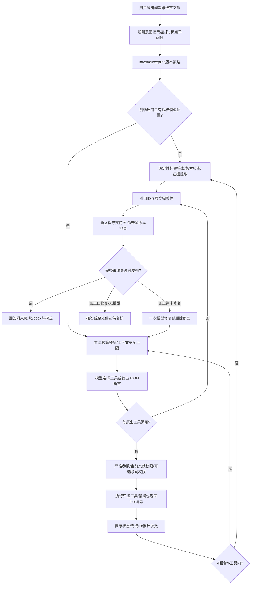

# 核心算法流程（实际实现）

图中I为已披露的规则提示，不是LLM推理。B累计所有实际请求尝试（包括失败和重试），费用未知保持null。S仅对完整原文表述作窄范围支持，不是通用语义蕴含；数值/版本差异是待核验候选。

真实模型不可用或预算超限不会发布模拟回答。无原生工具时可降为确定性RAG+真实JSON综合，并明确标记兼容模式。恢复要求同源指纹与权限、有效租约；完成记录只读返回，不重新计费。
