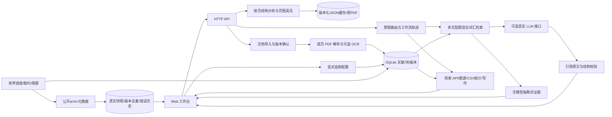

# 系统架构

数据与模型提示不具有工具权限；工具为白名单。PDF 原文保留，块含 page/bbox/标题信息。用户明确确认版本处理。模型密钥只来自环境变量，不进数据库和客户端。完整实现范围以 README 与验收矩阵为准。

第二阶段加入原生目录层级与按页表格候选、图注/图片/数学glyph索引；表格分析按需运行，缓存带源哈希和分析器版本，不把整页正文当表格。合并单元格/LaTeX未完整解决。追踪创建默认停用，每项最多48次，空列表无网络请求；真实模型不会由追踪器自动调用。
