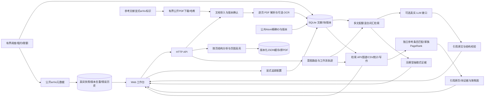

# 系统架构



数据与模型提示不具有工具权限；工具为白名单。PDF 原文保留，块含 page/bbox/标题信息。用户明确确认版本处理。模型密钥只来自环境变量，不进数据库和客户端。完整实现范围以 README 与验收矩阵为准。

第二阶段加入原生目录层级与按页表格候选、图注/图片/数学glyph索引；表格分析按需运行，缓存带源哈希和分析器版本，不把整页正文当表格。合并单元格/LaTeX未完整解决。追踪创建默认停用，每项最多48次，空列表无网络请求；真实模型不会由追踪器自动调用。

## 本次深度研发架构（PHASE2）
```mermaid
flowchart LR
 WEB[research.js版本/模式/证据/恢复] --> API[/api/research]
 API --> AGENT[ResearchAgent结果驱动循环]
 AGENT --> INTENT[research_intent规则提示]
 AGENT --> VERSION[versions来源版本策略]
 AGENT --> TOOLS[严格Pydantic只读工具]
 TOOLS --> RET[原BM25/字符RRF]
 TOOLS --> GRAPH[既有家族图谱/前沿候选]
 AGENT --> MODEL[ModelClient显式真实端点]
 MODEL --> LEDGER[(共享预算账本/工作流分组)]
 AGENT --> JOURNAL[(运行状态/原始响应/租约)]
 MODEL --> CHECK[evidence_verifier保守发布关卡]
 RET --> CHECK
 CHECK --> WEB
 WEB --> TRANS[translation段落/术语/保护标记]
 TRANS --> MODEL
 GRAPH --> MAP[research_map主题候选/来源时间线]
 MAP --> WEB
```

新模块不替换检索器，不引入未经验证的新模型。外部arXiv默认禁止，用户显式允许才可发送当前问题主题词；文档新增内容不得被模型当检索词外发。状态库/预算库不含API密钥，不随源码或检查点发布。原始21份库保持不变，新增3份跨应用领域PDF仅作隔离评测缓存。
